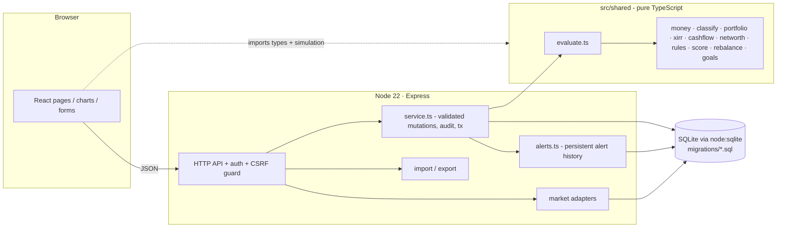
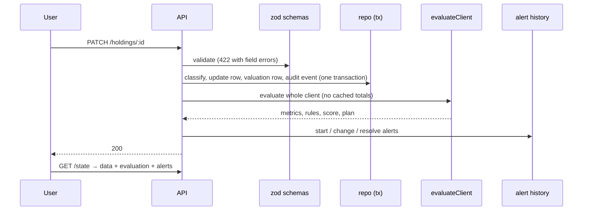
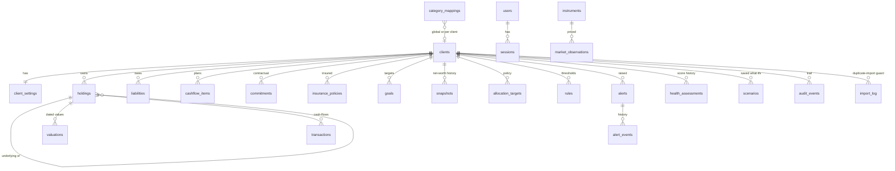

# Architecture

## Layers

Financial logic lives **only** in `src/shared`. The server evaluates after every mutation and persists alert history; the UI renders the server’s evaluation
(and uses the same module for local formatting/what-if types). Scenario simulation runs on a *copy* of the data on the server.

## Data flow (a single edit)

## ER diagram

## Key design points
* **Money = integer paise.** Exact sums; ratios derived only for display/thresholds.
* **Aggregate vs underlying:** `parent_id` self-reference; the engine replaces an aggregate by its children and keeps an *unallocated remainder*, so nothing is double counted.
* **Unknown ≠ zero:** unresolved classifications produce `[min,max]` bounds; rules return `triggered | possible | not_evaluable | ok | disabled`.
* **Alert history:** unique partial index `(client_id, fingerprint) WHERE status != 'resolved'` makes duplicate live alerts impossible at the database level.
* **Demo isolation:** fixtures flagged `is_demo`; reset only deletes/re-inserts fixture clients (Priya + 3 cases).
* **Transactions:** every multi-row change (`tx()`), import and reset is atomic.
